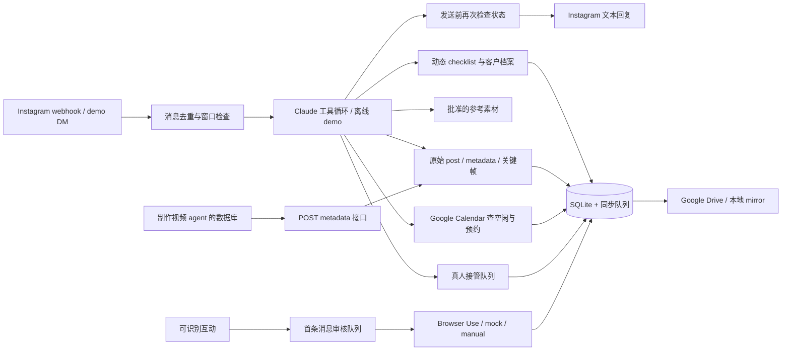

# 获客工作流与运行架构

本项目是一个 Node HTTP 服务、SQLite 本地存储和无前端依赖的工作台。外部服务经 adapter 调用；没有自动发帖或视频生产逻辑。

## 主要模块

| 文件 | 职责 |
| --- | --- |
| `server/app.mjs` | HTTP 路由、webhook 签名、上传、工作区 token、静态文件 |
| `server/store.mjs` | `(kind,id)` 主键的 SQLite JSON records，旧表自动迁移 |
| `server/acquisition/config.mjs` | 配置校验、原子热加载、失败保留上版 |
| `server/acquisition/service.mjs` | 客户状态、事件、工具执行、队列、接管、幂等 |
| `server/acquisition/agent.mjs` | 离线规则 demo 和 Claude Messages 工具循环 |
| `server/acquisition/policy.mjs` | 发送资格、事实更新、活跃/意向/匹配、转化分母 |
| `server/acquisition/providers.mjs` | Google Drive / Calendar / Instagram API 与 mock |
| `server/acquisition/calendar-slots.mjs` | 按公司时区生成工作时间，处理夏令时 |
| `server/acquisition/content.mjs` | 原始 post metadata、revision、raw lineage、关键帧检查 |
| `server/acquisition/browser-runner.mjs` | 单个批准任务的 Python worker 执行和中断 |
| `tools/browser_outreach.py` | 可选 Browser Use + Claude 页面操作 |

## 数据模型

Contact 是 Instagram 身份；Project 是一次建房/装修需求；Conversation 指向当前项目。同一客户可开始新项目，旧资料保留。消息、工具记录和每个事实都有来源 ID。字段值区分 confirmed / inferred / unknown / declined，保留旧值历史。

Conversation mode 独立于商机阶段：auto / review / awaiting_human / human / paused。owner version 与 message version 防止慢模型返回后发送过期回复。真人接管、退订和后来的客户消息使尚未发送的旧草稿失效；已经派发给外部平台的网络动作无法保证撤回。

## 工具

- `update_customer_fields`：按已加载 schema 校验后持久化。
- `note_question`：记录本轮询问字段，避免反复追问。
- `search_business_knowledge`：配置里的公司资料。
- `get_post_context` / `inspect_video_segment`：准确 post 和片段来源；详细协议见 [video-metadata.md](video-metadata.md)。
- `search_project_media` / `send_project_media`：只用已批准参考素材，不访问客户附件。
- `check_calendar_availability` / `book_meeting`：只接受用户选中的未过期时段；预约前再查空闲。
- `request_human_handoff`：默认 topic scope，只把具体问题传给团队，agent 继续服务；conversation scope 才暂停整段对话。
- `schedule_followup`：到期再检查窗口、退订、接管、新消息和已预约状态。
- `get_project_estimate`：off 时不注册；review 时不向对话模型透露未批准金额。

## 重要状态与结果

- `simulated_sent` / `simulated`：明确是本地演示。
- `sent`：外部服务确认接受，仍不等于已读或送达。
- `send_unknown` / booking `unknown`：无法确认外部写入，禁止盲重试，需要核实。
- `draft`：待人工批准。
- `local_mirror`：写到本地 Drive 镜像，不等于云同步。
- `synced`：真实 Google Drive API 成功。

预约有确定性 Google event ID；异常时可用同一 ID 查询。进程内串行检查避免本实例重复占时段，但 Google Calendar 本身不提供跨所有写入方的原子“空闲则插入”，其他人可能同时改日历；多副本部署还需要数据库级锁。

## API 概览

| 路径 | 用途 |
| --- | --- |
| GET `/api/state` | 当前工作台资料；需要工作区权限 |
| POST `/api/contacts` | 添加已识别潜客 |
| POST `/api/contacts/:id/messages` | 模拟来信；live Instagram 下禁用 |
| POST `/api/contacts/:id/mode`、`reply`、`handoff` | 接管、人工回复、转交 |
| PATCH `/api/contacts/:id/facts`、`project` | 校正资料 / 阶段（lost 必须明确原因） |
| POST `/api/contacts/:id/projects` | 同一客户的新项目 |
| POST `/api/contacts/:id/outreach`、`followup` | 首触达草稿、跟进任务 |
| POST `/api/messages/:id/approve` | 审核后发送草稿 |
| POST `/api/outreach/:id/execute`、`reconcile` | Browser 执行与结果核实 |
| POST `/api/bookings/:id/cancel`、`reconcile` | 取消预约 / 核实未知结果 |
| POST `/api/interactions`、`content-metrics` | 可识别互动 / 匿名内容统计分别入库 |
| POST `/api/assets`、PATCH `/api/assets/:id` | 上传参考图片、批准分享 |
| POST `/api/library/import-drive` | 导入指定 Drive 源图片，默认未批准 |
| POST `/api/contacts/:id/attachments` | 私有客户附件 |
| POST `/api/handoffs/:id/resolve` | 核实某个问题，可原文发送到 Instagram，保留 agent 状态 |
| POST `/api/content/sources` | 只有原视频、尚无详细 metadata 时登记来源 |
| POST `/api/content/posts` | 视频 agent metadata 幂等入库 |
| GET `/api/content/posts/:id` | post、片段、raw source 与允许披露的事实 |
| POST `/api/content/posts/:id/inspect` | 给定片段的关键帧/metadata 检查 |
| POST `/api/contacts/:id/source-post` | 人工绑定准确 post |
| PATCH `/api/settings` | automation / quote / cohort 配置 |
| POST `/api/config/reload`、`sync/run`、`tasks/run` | 热加载、重试同步、处理跟进 |
| GET/POST `/webhooks/instagram` | Meta challenge / HMAC 校验后的入站事件 |

旧 `/api/campaigns`、`/api/leads`、`/api/estimates` 返回 410，防止进入旧营销/无开关估价流程。

## 后台和恢复

`server/index.mjs` 每 15 秒处理 queued 消息、到期 follow-up 和 Drive 同步。消息处理中断交给真人；发送中断进入 unknown；预约 pending 恢复为 unknown。没有“循环追问直到回复”的行为：一次客户对话后最多安排一个温和跟进，该跟进不会自我生成下一轮跟进。

Drive 同步最多每批 150 个记录，失败保留 payload 和重试次数。源 metadata、客户消息/资料和聚合表均保留，私有附件与参考素材目录分离。同步队列是单向投影，SQLite 当前负责事务和运行时状态。

## 后续实际账号联调

当前仍需真实验证：Claude、Google OAuth 和日历权限、Drive 文件权限、Instagram 消息事件/文本发送、Browser Use 已登录 profile、制作 agent 的 metadata 结构。只用截图或 mock 不代表外部服务写入已验证。

首版不含公网客户签名表单链接、多租户 RBAC、完整互动回填/Insights 拉取、原生 Sheets 写入、Instagram live 图片投递、自动读取客户发来的图纸。接口清楚区分这些待接入能力，避免伪装成功。

人工补充一条回复会使尚未发送的 AI 草稿失效（递增 message version），但不改变 conversation mode。Topic 待办的完成状态独立于 Take over / Return to assistant，切换对话所有权不会误把具体问题标为已解决。
